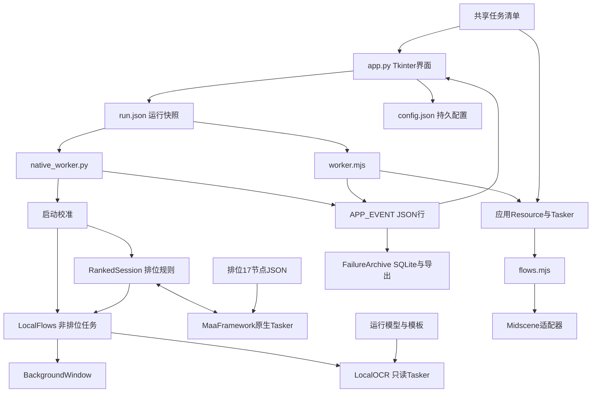
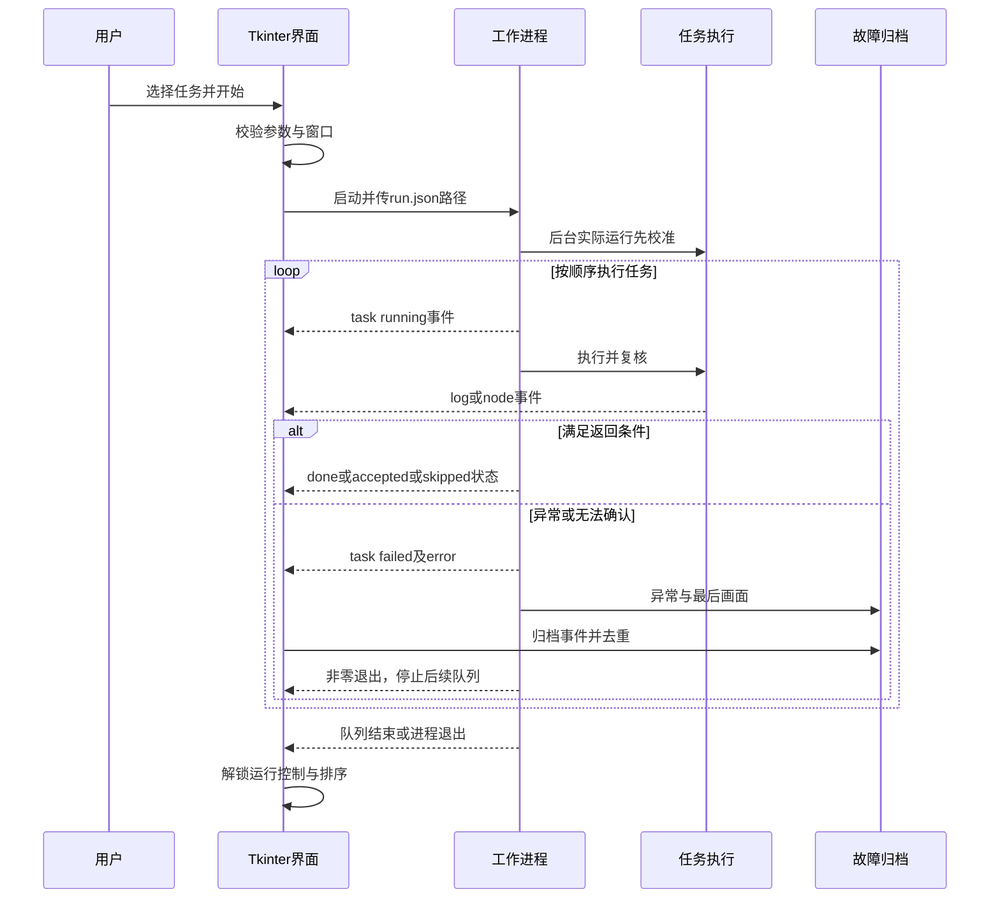

# 火影忍者 Online 助手技术文档

面向开发维护和项目交接。竞技场章节更新至2026-11-06（北京时间）：入口已迁至“小工具 → 竞技场”独立运行，保留蓝色“确认”修复、人工降级、自动领奖及三模式限场；旧后台悬停调查仅保留历史，不继续实施。其他任务保持原实现与验收边界。本文维护详细实现、已知问题和验收证据；优先待办及授权见[任务状态](任务状态.md)，导航见[上下文索引](../verification/任务上下文索引.md)。

同一事实只在主要位置展开维护：任务状态保存目标、有效约束和优先级；本文件保存实现、问题与验收；使用说明保存启动和界面操作；后台说明保存运行条件和操作注意；架构说明保存结构概览；索引只导航。其他文档简述或链接，不复制历史改动、废弃决策及旧测试批次。代码行为与目标分别说明，代码存在不等于实机验收。

## 目录

- [项目与运行边界](#项目与运行边界)
- [部署检查](#部署检查)
- [模块与架构](#模块与架构)
- [界面与工作进程](#界面与工作进程)
- [配置接口](#配置接口)
- [控制与事件协议](#控制与事件协议)
- [后台截图输入与识别](#后台截图输入与识别)
- [任务规则与状态](#任务规则与状态)
- [竞技场打开界面](#竞技场打开界面)
- [排位战原生流水线](#排位战原生流水线)
- [资源接口](#资源接口)
- [故障归档与调试](#故障归档与调试)
- [新增任务与资源维护](#新增任务与资源维护)
- [测试与验收](#测试与验收)
- [核对事项](#核对事项)

## 项目与运行边界

项目是Windows上的Tkinter桌面助手，在指定的360游戏大厅火影忍者Online窗口执行用户选择的生存演习、强者降临、游戏内托管、排位战、通缉任务和押镖接取；竞技场支持入口、自动领奖及三模式限场战斗，当前仍有实机验收待办。通缉和竞技场仅支持本地后台，UI会阻止选择Midscene执行这些任务。游戏任务没有Web服务或HTTP业务接口；ui-preview中的网页及可选静态服务是独立演示，边界见[独立网页预览](#独立网页预览)。

后台验收约束为不抢前台、不移动真实鼠标、不向当前输入焦点发送按键。游戏可被遮挡，不能真正最小化；用户可操作其他应用，但不应改变目标游戏窗口或游戏页面。现有受控证据不证明持续并发键鼠压力条件下的稳定性。

不购买挑战次数、不付费刷新、不保险押送、不充值或改变阵容。托管仅允许按已确认规则消耗一张已有托管卡，数量未知、卡不足或购买提示停止。识别不可靠必须停止，不能猜数字、把未知胜负认定为战败，或重复发送结果不确定的消耗动作。

| 项目 | 本地后台（默认） | Midscene（可选前台） |
| --- | --- | --- |
| 入口 | native_worker.py | worker.mjs |
| 识别 | 本地Maa OCR、模板、字形复核 | 视觉模型SDK查询和断言 |
| 截图／输入 | 根窗口FramePool／渲染子窗口消息 | 桌面截图／真实鼠标键盘 |
| 游戏前台 | 不主动激活，允许遮挡 | 实际运行前恢复并切到前台 |
| 模型API | 不需要 | 需要模型连接参数 |
| 业务调度 | 排位原生Maa流水线；其他LocalFlows | 应用Resource／Tasker及flows.mjs |
| 后台不干扰 | 目标运行方式，有局部实机证据 | 不满足该约束 |

操作入口见[使用说明](使用说明.md)和[后台使用说明](后台使用说明.md)，结构概览见[架构说明](架构说明.md)。

## 部署检查

### 本地后台环境

启动脚本切换至项目目录，执行pythonw app.py，失败后尝试python app.py。窗口捕获和输入依赖Windows及目标360客户端，不能作为跨平台应用部署。

| 依赖 | 当前事实与要求 |
| --- | --- |
| Python | 本机3.14.3、AMD64；vendor NumPy wheel标签cp314-cp314-win_amd64，直接复用须匹配Python 3.14／Windows x64 |
| Tkinter／Pillow | 本机导入检查为Tk 8.6、Pillow 12.2.0，启动解释器须可导入两者 |
| MaaFramework | vendor MaaFw元数据v5.14.3，Python SDK及原生运行库须完整 |
| Maa依赖 | vendor含MaaAgentBinary 1.0.1、NumPy 2.5.4、StrEnum 0.4.15 |
| OCR | resources/local/ocr中的det.onnx、rec.onnx、keys.txt |
| 模板 | resources/local/image中的运行图标和字形；不能用catalog代替 |

源码和Maa包的最低Python声明不代表随附二进制兼容所有这些版本。更换Python版本须重新准备匹配依赖和原生库，完成导入、模型及离线验证。项目没有完整Python环境安装脚本或锁文件。

在项目根目录执行以下只读环境检查，不连接游戏：

```powershell
python --version
python -B -c "import sys; sys.path.insert(0, 'vendor'); import tkinter, PIL, numpy, maa; print('imports OK')"
Test-Path resources/local/ocr/det.onnx
Test-Path resources/local/ocr/rec.onnx
Test-Path resources/local/ocr/keys.txt
```

确认python与pythonw使用同一兼容环境。导入成功不替代原生Tasker、模型加载或真实窗口验证。

### 可选前台环境

需要Node和npm。package.json声明@midscene/computer为^1.0.0，安装以package-lock.json为准，当前安装版本为1.15.0。本机Node v24.21.0；项目未声明完整最低Node兼容矩阵。安装依赖.cmd仅执行：

```powershell
npm.cmd ci --no-audit --no-fund
```

它不安装Python依赖、DLL或OCR模型。模型环境变量见配置接口；本文记录项目现有SDK用法，不保证外部模型服务当前兼容性。

## 模块与架构



| 模块 | 主要职责 |
| --- | --- |
| app.py | 界面、窗口列表、参数校验保存、进程控制、日志、排序和事件消费 |
| mission_desk_ui.py／wanted_task_ui.py | 桌面工作台构建、样式和状态展示；通缉任务设置说明 |
| native_worker.py | 后台入口、命令线程、校准／诊断、队列分派、事件与异常归档 |
| adapters/background_window.py | 根窗口截图、子窗口查找、校准、DPI映射和消息输入 |
| adapters/local_ocr.py | 模型与模板，独立只读Controller／Resource／Tasker |
| local_flows.py | 本地任务状态、定位与操作，提供排位复用的识别方法 |
| wanted_task.py | 由LocalFlows.wanted委派的独立通缉流程，免费确认、次数复核与主页收尾 |
| ranked_pipeline.py | 会话账本、活动时间、Custom回调、原生Tasker及结果验证 |
| ranked_vision.py／ranked_numbers.py | 我方红字和次数；对手纯数字区、字形／OCR集中裁决与诊断 |
| ranked_policy.py／survival_plan.py | 排位范围与上限；生存等级计划和积分估算 |
| worker.mjs／core | 前台入口、应用资源校验、顺序节点和队列事件 |
| flows.mjs／adapters/midscene.mjs | 前台规则及SDK适配，提供act/query/verify/until/wait/log接口 |
| failure_archive.py | 运行编号、故障追踪、分类去重、SQLite及Markdown／JSON导出 |
| resources／tools／verification | 运行与采集资源、准备和探针工具、验证证据 |

本地队列不使用JavaScript Tasker。LocalFlows仍有直接排位方法，但默认后台明确调用run_ranked_pipeline；不可只修改未被默认入口调用的方法。

## 界面与工作进程

当前app.py的build、build_log_view和update_nav委派[mission_desk_ui.py](../src/mission_desk_ui.py)构建“木叶任务簿”桌面工作台；任务参数仍由App及wanted_task_ui提供，执行按钮继续调用App.start／pause／stop，走现有工作进程。侧栏提供任务面板、运行记录、小工具和设置，三栏保留任务队列、参数及日志；任务行使用“参数／编辑中”，开始按钮为“开始执行”。参数和两个日志视图无可见滚动条，保留滚轮与日志自动跟随。

正式桌面替换已交付，沿用启动.cmd→app.py，无需网页服务。该UI交付阶段新增界面模块，App变更限于__init__、build、update_nav、build_log_view、layout_panes、show_task、update_task_drag、cancel_task_drag，其余方法与[替换前备份](../verification/app-before-mission-desk-20261017.py)的AST一致；配置、执行控制和事件消费方法保持。[接口核对报告](../verification/mission-desk-ui-contract-20261017.json)记录的是当时文件哈希，后续研发已修改部分后台源码，用户配置与日志也有运行更新，不将旧哈希当作当前仍未变化的证明。

[桌面替换交接](../verification/UI木叶任务簿替换-20261017.md)已补齐命令、范围及执行顺序：`python -B -m unittest tests.tests_task_layout tests.tests_task_order tests.tests_wanted_ui tests.tests_mission_desk_ui`的[综合输出](../verification/mission-desk-ui-tests-20261017.txt)为26项通过、47.083秒；最后修改拖动配色后，`tests.tests_task_order tests.tests_mission_desk_ui`的[复验输出](../verification/mission-desk-ui-final-checks-20261017.txt)为10项通过、19.635秒。隔离测试覆盖三种窗口尺寸、六任务布局与参数、排序和配置、协议事件呈现、独立滚轮及日志跟随；测试禁止真实Popen，协议事件为注入数据。交接另记录正式窗口打开与排位参数点击，保存[真实桌面截图](../verification/mission-desk-native-20261017.png)。这些证据不含游戏任务执行、真实暂停／停止或其他操作系统验收，现有后台问题保留。

10月16日滚动条检查及通缉接入阶段的145项报告只证明各自当时版本；桌面替换后的UI依据以上专项交接，不沿用网页浏览器检查作为桌面验收。10月19日通缉阶段只同步辅助说明，未重新进行桌面视觉验收。

Tk主线程负责控件。stdout读取线程把行转换为事件，归档后放入线程安全队列；主线程约每100毫秒drain更新日志和状态。OCR、模型调用与战斗等待在独立子进程执行。

任务ID和名称从共享清单读取。taskOrder记录含未勾选任务的完整排序，tasks记录按排序筛选的实际队列。加载排序时去重、移除未知ID，并追加新清单任务。拖动、右键、快捷键调整后自动保存；运行／暂停锁定排序。启动校准不参与用户排序。

开始时校验任务参数，实际运行重新枚举窗口获取本次句柄，调用save保存设置，生成runId并写run.json。当前save失败只提示，启动流程不检查保存结果，可能仍继续启动；这属于未修复问题，不是允许忽略保存失败的规则。后台使用当前Python解释器，前台使用PATH中的Node；stderr并入stdout，UTF-8读取，Windows隐藏进程窗口。前台实际运行会最小化助手并恢复、激活游戏。



预览在连接游戏之前返回，后台诊断仅取当前窗口截图并OCR，不校准或执行任务。暂停是协作检查点，不中断已进入的SDK调用。停止发送命令并同时终止进程树，不保证每个原生调用可即时协作取消。

### 独立网页预览

[木叶任务簿网页](../ui-preview/mission-desk/README.md)支持六任务选择、排序、参数、专用localStorage保存及开始／暂停／停止演示；不读写项目用户配置，不连接桌面工作进程、OCR、Maa或游戏输入。可本地直开HTML，可选server.mjs仅提供静态资源。其计时演示不按参数真实执行挑战；桌面同名模块的验证单独核对，不能把网页交接中的“集成待实施”当作当前桌面源码状态。

该网页交付的[交互报告](../ui-preview/mission-desk/browser-results.json)为21项通过，[响应式报告](../ui-preview/mission-desk/responsive-results.json)覆盖375／768／1024／1440宽度无横向溢出；[自动无障碍报告](../ui-preview/mission-desk/accessibility-results.json)为0违规类别，仍有1个未完成类别、2个单字节点待人工判断。浏览器窄屏不等于真机触屏，file直开已验证，不把批处理双击、跨浏览器或游戏任务写为已验收；完整范围见[网页交接](../ui-preview/mission-desk/验证与交接.md)。

[滚动交互预览](../ui-preview/scroll-studies/README.md)是另一份独立网页，展示六种滚动效果；其桌面14项、窄屏7项测量及2项滚轮检查仅证明该网页，见[验证记录](../ui-preview/scroll-studies/验证记录.md)。未接入游戏，也不证明桌面已实现这些动效。

## 配置接口

config.json是GUI持久设置，run.json是运行快照；worker消费启动参数指定的文件。下表为代码默认值，不是用户当前配置。

| 运行字段 | 类型／默认值 | 含义与校验 |
| --- | --- | --- |
| tasks | string[] | 所选任务ID按执行顺序排列，普通运行不能为空 |
| taskOrder | string[] | GUI完整排序，worker实际循环用tasks |
| backend | string／本地后台（免API） | 另一个GUI选项为Midscene（前台），诊断强制本地 |
| difficulty | string／阿修罗级 | 天级、夜叉级、阿修罗级 |
| reset | boolean／true | 是否使用生存免费重置 |
| survivalGrades | string[]／全部五级 | 至少一个有效等级且不重复，按固定等级序执行 |
| survivalCounts | object | 所选等级的整数预算；默认SS1/S2/A2/B3/C5，SS为1、其他1至30 |
| survivalInitial／survivalGoal | int／60、220 | 仅估算；0≤起点≤目标且目标>0，不控制实际满分 |
| tolerance | number／20 | 战力差百分比，GUI启动检查0至100 |
| rankedServer | string／连服 | 本服或连服，接受联服别名并规范为连服 |
| rankedLimit | int／0 | 0表示用完剩余，1至20为本次上限 |
| arenaMode | string／休闲战斗 | 段位战斗、休闲战斗、日常模式；接受排位别名。日常模式按实际战令段位优先，归零转休闲；字段缺失只做入口诊断 |
| arenaBattleLimit | int／3 | 竞技场三模式共用1—100场上限；胜败结算并返回均计1场，到上限后领奖收尾，不为耗令追加匹配 |
| battleSeconds | int／900 | 单场等待，GUI启动检查30至3600秒 |
| hostingMinutes | int／90 | 托管等待，GUI启动检查1至240分钟 |
| escortRefreshLimit | int／4 | 免费刷新上限0至20 |
| escortGrade | string／SS | SS或S，严格区分 |
| displayId | string／空 | 前台显示器ID，空值由SDK默认处理 |
| preview | boolean／false | 运行快照字段，预览不操作游戏 |
| diagnostic | boolean | GUI生成的本地只读连接检查标志 |
| gameHwnd | int | 本次根窗口句柄，实际运行或诊断使用，不跨次硬编码 |
| runId | string | 运行唯一编号，供归档去重 |

GUI save另写battle_seconds、hosting_minutes、escort_refresh_limit、escort_grade、display等控件对应字段，load读这些形式；同时保留config()生成的camelCase运行字段。model、base_url、family为持久模型参数。配置迁移必须核对GUI load/save和worker读取，不能假定控件只读运行字段；优先在界面保存，避免手写两套矛盾值。

生存未选中时GUI可保留空等级，执行时仍须至少一级。缺失survivalCounts的兼容输入不设明确每级预算，流程仍有循环上限；GUI提供明确预算。

前台适配器要求以下四项非空：

```text
MIDSCENE_MODEL_NAME
MIDSCENE_MODEL_BASE_URL
MIDSCENE_MODEL_FAMILY
MIDSCENE_MODEL_API_KEY
```

API Key仅在内存和前台子进程环境，不写配置或快照；后台环境移除MIDSCENE_MODEL_前缀变量。日志和归档针对已知密钥清理，不代表账号、桌面截图及任意秘密已全面脱敏。

## 控制与事件协议

入口为 `python native_worker.py <快照路径>` 及 `node worker.mjs <快照路径>`，GUI以参数列表启动。直接运行worker可能操作游戏，应通过GUI选择任务与窗口。

stdin为换行分隔文本，命令pause/resume/stop，每次写后flush。后台用线程Event，前台用布尔状态；未知命令无业务动作。paused事件确认到达暂停点，GUI之前显示暂停中。正常返回退出码0，异常非零；GUI合成exit事件处理结束。

stdout事件为 `APP_EVENT ` 前缀加一行JSON。缺少前缀、JSON无效或kind无效按普通日志；message转换字符串。下例仅说明格式，传输时需加上述前缀：

```json
{"kind":"task","message":"排位战：后台运行中","id":"ranked","status":"running"}
```

| kind | 常用字段 | 消费行为 |
| --- | --- | --- |
| log | message | 日志和归档上下文 |
| task | id、status | running/done/failed/preview/accepted/skipped等状态 |
| node | id、node、status | 步骤；本地排位还有completed、remaining、limit，remaining可能null |
| paused | message | 确认暂停，允许继续 |
| done | message | 队列结果文字，不证明所有业务完整完成 |
| error | manual、failure | 失败／人工停止及归档 |
| exit | message为退出码字符串 | GUI合成，解锁控制，异常可补记故障 |

failure可含taskId、step、exceptionType、traceback、source、screenshot、evidenceNote。source含文件、行及可用函数／列；缺失字段记未知。

后台押镖接取为accepted，排位零次为skipped；生存已领奖、强者零次和押镖零次不一定输出skipped。不能从done反推发生了战斗。前台成功返回统一done，差异见核对事项。

## 后台截图输入与识别

### 窗口绑定与校准

BackgroundWindow检查根句柄存在、未最小化，且属于枚举出的可见、标题匹配火影忍者的360Game.exe窗口。子窗口NativeWindowClass必须唯一，不能随机挑候选。

根窗口Win32Controller用FramePool原始尺寸截图；输入直接发给渲染子窗口。构造截图控制器时填入的PostMessage参数不代表当前使用SDK默认点击。

目标客户区1920×1015，最大化时不激活恢复；校准根窗口居中，最多12次设置，每次启动均验证尺寸与截图。11月5日旧固定外框候选1920×1147曾通过，但23:49故障再次出现；不能把旧实测成功等同于所有启动均可靠。

11月6日实测确认360滚动条布局具有路径依赖：同一实际外框1920×1148，游戏区可能为1920×1041或1920×1015；单轴高度夹逼可在1894×1006与1920×1033之间跳变，单纯增加等待或重复同尺寸设置无效。现保留首候选1920×1147；若测得游戏宽度正好1920而高度超出1015，则保存当前实测外框，用超高量临时扩宽根窗口，下一步还原保存的物理外框。本机请求1147会取整到1148，因此还原实测1148，不还原请求1147。实际重置路径1946×1148→1920×1148后稳定得到1920×1015。若仍失败，再尝试旧1920×1122候选和原高度优先单轴夹逼；保持原总次数上限、后台不激活及中止检查。

只调整根窗口；不缩放截图、不直接调整Native／内容容器、不更改桌面分辨率。任何候选都需几何稳定且实际截图1920×1015才放行；最小化、句柄变化、截图异常、不可达均停止后续任务。首候选成功或启动时已是正确尺寸则直接验证返回，不做多余重置。

本轮40项离线回归通过，新增6项专用校准测试，包含布局历史／系统取整、拒绝调整、不可达／循环上限及截图尺寸不符。原方法在布局历史回归中复现不可达错误，修复后通过。正式代码实测两种错误尺寸1894×990、1920×1041及已校准重复启动均通过，每组三次稳定测量及完整截图；未发送游戏输入。证据：[实机报告](../verification/startup-calibration-live-20261106.json)、[回归与公共文件保护](../verification/startup-calibration-tests-20261106.json)、[专属技术说明与交接](../verification/启动校准游戏区域修复交接-20261106.md)。仅当前桌面环境已实测，其他分辨率／DPI和实际业务链仍需另行验证。

### 截图与坐标

capture前后比较外框尺寸、渲染客户区尺寸及相对偏移。根截图须与外框尺寸接近，裁剪区域合法且足够大；图像标准差过低视为黑屏／未加载。返回游戏区域BGR数组，保存时转RGB。

10月18日22时故障只读诊断（内存问题未修复）：[22:39记录](../出错任务/生存演习/记录/bc68a0cdc0fbf531c17e617c.json)由check中的IsIconic(root)直接判断窗口最小化后中止，与允许遮挡的约束不同。[22:06记录](../出错任务/生存演习/记录/e3c4135723019a46858d9f19.json)发生在capture的image.std黑屏检测，NumPy申请(1015,1920,3) float64临时数组44.6 MiB失败；同一时段还有OpenCV约46.8 MB分配失败及[22:07原生内存失败退出](../出错任务/生存演习/记录/18bf47a7e4ea627f1034a386.json)。已确定这些路径申请内存失败，尚未确定系统／分页文件资源余量与程序占用增长各自责任。待核对内存趋势、减少截图临时数组并验证资源释放；该诊断阶段只读堆栈与源码，未运行游戏或改系统设置。后续积分识别修复仅改LocalFlows，不改变此截图检查；三类故障不合并为一个根因。

click必须有此前capture的geometry，且与当前测量相符。物理截图坐标映射到渲染消息客户区：

```text
mx = floor(x * message_width / physical_width)
my = floor(y * message_height / physical_height)
```

输入前切线程DPI上下文至目标窗口上下文，结束恢复。默认SendMessageTimeout依次发送WM_MOUSEMOVE、WM_LBUTTONDOWN、WM_LBUTTONUP，单消息1000毫秒超时，按下后约80毫秒间隔。适配器保留PostMessage参数，但GUI未提供切换。

消息成功只代表提交，效果由业务重识别。窗口、截图、输入错误停止，无真实鼠标回退。绝对位置移动可能不改变所有测量字段，不能保证任意移动均检测到；运行中仍需保持窗口不变。

### 本地识别

LocalOCR独立Resource／ReadOnlyController／Tasker；只读控制器拒绝点击、键盘、启动应用和触摸等动作，不和排位流水线共用Tasker。

read输出text、box、score，box为游戏图像像素[x,y,w,h]，OCR分数过滤0.65。match按名称_*.png查运行模板，默认阈值0.86，业务可用更严格门槛；输出box、score、template并去重近位置命中。不能称所有任务统一阈值。

observe更新截图、OCR与background-latest.png，文本正则和模板定位；点击匹配框中心，文字按钮要求唯一。confirm重新截图、排除付费提示并可用guard检查当前弹窗。有效要求是数字、按钮或页面冲突时停止；对手读数复核当前实现见下段，已知问题及验收边界见[核对事项](#核对事项)，不外推为所有识别路径已全部验收。

ranked_vision对红色斜体我方战力逐字匹配，运行0—9覆盖；0.92匹配门槛、0.08领先差及未知字形双渲染复核保持。次数单独读取。对手当前生产路径已统一为[ranked_numbers.py](../src/ranked_numbers.py)，LocalFlows.ranked_state不再调用旧read_opponent_power文案分支；旧API和单样本工具保留用于历史报告复现与离线制库对齐。

用户批准重构后的对手读取：在已确认排位页的五个唯一挑战按钮上方，按控件相对位置定位白色数字前景，校准1920×1015、数字高12—14／宽20—100像素。数字定位不依赖全句“战斗力”，也不让错误文案参与数值投票。原色数字及2px原背景边距提供3／4倍only_rec，必要时1.25横向视图；仅4—9位非前导0且分数≥0.8的纯数字视为有效OCR，不做字母或百分号替换。

独立字形证据每次同时执行：4张历史原图提供68份去重变体，0—9每字3—11份，来源、原裁框及文件／像素SHA256在[bank.json](../resources/local/ranked_numbers/bank.json)。不新增单字PNG，不按完整战力查表；完整标签只用于离线制库／审计。匹配按字宽±1搜索切分，可切穿粘连，窄1的固定字距可跨最多6空列。190／200掩码各自要求平均IoU≥0.8、逐字最低≥0.65、完整候选总成本领先≥0.08，两种掩码须同值才算合格。它们是同一图形的质量检查，不能视为两份完全独立证据。

arbitrate集中裁决：任何有效OCR数值之间冲突或与合格字形冲突均停止；唯一有效OCR与合格字形一致才接受。OCR没有有效纯数字时，允许两掩码均平均IoU≥0.9且逐字最低≥0.75的高质量字形独立恢复；即使同一OCR多次同值，没有合格字形也不接受。不同frame_seq至少两帧的次数／我方／五对手签名一致后才决策；同帧回调重复不算第二帧。未知外观仍可有限只读重试，不重放不确定输入。

失败时native_worker保存最近一次数字诊断至verification/failure-<run>-ranked-numbers[/序号]，包含原色数字裁片、相对／实际框、OCR视图读数／分数、字形候选质量、裁决原因、哈希与时间；evidenceNote链接evidence.json并注明不一定与最后截图同帧。相同目录已有文件时另起后缀，诊断保存失败仍报告原异常；归档事务等既有问题另列待办。

最新02:16故障的674651／750130以及960878图均留出未参与建库。8张真实图40条战力（20来自制库源图、20来自留出图）均有合格字形并正确接受；196项后端测试包括旧文案缺失、%误读、纯数字冲突、遮挡／尺寸／空白负例、源哈希损坏、双帧、真实数字接入模拟两场刷新／胜败／确认／主页，以及通缉接续。当前[机器报告](../verification/ranked-unified-numbers-20261019.json)、[制库工具](../tools/prepare_ranked_number_bank.py)、[复核工具](../tools/verify_ranked_numbers.py)、[字形预览](../verification/ranked-number-variant-contact-20261019.png)。旧[174项裁决报告](../verification/ranked-oct19-latest-probe.json)与[单字后备报告](../verification/ranked-white-template-recognition-20261019.json)只证明当时版本；不能据离线数据保证所有字体、分辨率或实机整轮稳定。

## 任务规则与状态

### 生存演习

页面复核→面板或遗留弹窗→积分／重置稳定→按设置重置→计划选级→开战与自动／二倍速→结算→重新读积分→满分领奖→已领复核→主页。

先明确重置次数，reset且1次时重置并等0次；满分不能绕过应执行的重置。等级固定序，只执行勾选级，受本次预算和游戏次数限制。积分估算不参与实际满分判断。每场更新预算并重读状态，积分与候选状态不变停止。满分后核对领取状态，已领可返回；预算耗尽未满分或30轮上限时报错。

10月19日积分／SS交接（失败发生在10月18日23:47）：[原始记录](../出错任务/生存演习/记录/09ece113393d796fff0af963.json)报积分稳定等待超时，[原图](../verification/failure-20261018-234702-3aa6ed0d9603-survival.png)是精英页80/210、SS剩余0、S剩余2。全图OCR为“演习积分:80/2]0”，旧search未限定全文，把它截为80/2并以积分无效阻塞后续等级选择。该次并未进入SS挑战读取，原survival_candidate直接读图已能跳过SS0并选择S2。

- 已决定：保持SS优先、0次耗尽、重置及计划限制；不把]替成1、不固定目标220／210，也不为SS创造次数。局部OCR同时要求两种倍率一致，普通与精英样本均须保留。
- 已实施：仅修改local_flows.survival_points与tests_local.py。全图先要求唯一“演习积分”锚点、完整“演习积分:数字/数字”格式及分数≥0.8；格式损坏或低分时在既有积分ROI按2／3倍only_rec，各恰好一项、分数≥0.85、完整数字比率且两读相同才接受，最后仍验证目标>0及积分≤目标。无锚点、歧义、局部冲突、低分、损坏及不可能比率均停止。UI／模式切换／估算／次数选择不改。
- 已验证：新增4项，修复前2项均复现积分无效（3.902秒）；生存与计划35项通过（40.513秒），最终191项后端通过（144.046秒，35生存／计划＋原156通缉／排位）。最新图双读80/210约0.9987并通过重置0的稳定等待，SS-only计划停止耗尽；两份旧普通140/220约0.870—0.887仍通过。原先试用0.9局部门槛会拒绝旧样本，最终0.85门槛加双读保留基线；旧局部读取原本没有分数门槛。2份源码语法通过，14份配置／UI／原任务／日志／故障文件及144份模板哈希不变，未增素材。完整命令、原始OCR及源图／源码哈希在[机器报告](../verification/survival-points-recognition-20261019.json)。测试仅子进程OPENBLAS／OMP线程为1，未改系统或永久环境。
- 未完成：无实机游戏操作，当前图SS0不具备挑战条件；后续SS有次数时的实际运行另行验收。内存失败仍待调查，不能称本次已修复。精英图210目标与原UI普通模式积分估算有差异，仅记录待办，不新增模式切页或配置。

恢复先查任务状态及机器报告，不把离线点击／次数检查当作实际消耗挑战。

### 强者降临

面板→三个难度及普通奖励稳定→零次返回或选择难度→战斗→读取胜利标记并确认结算→可选分数确认→主页→根据此前胜利标记返回或报错。

本地左侧普通奖励两帧复核，不混用组织次数，只执行一场。battle()先取得victory布尔值并确认结算；strong()处理查看分数、返回主页后，若未确认胜利才抛错。这描述当前实现，不表示未知胜负可以报告完成。前台失败路径也可能先退出结算，不能称所有后端未知胜负均保留页面。

### 游戏内托管

小电脑／已有设置／首次弹窗／托管中识别→启动→一张已有卡确认或直接进入→托管中→全画面匹配“托管结束”→温泉关闭→离开家园→主页。

本地入口最多等15秒，首次确认最多一次，须看到托管中。卡数量不是一、未知或购买不能确认。当前启动时遇到已有“托管结束”会停止，但后续匹配未限定本轮托管日志。目标是可靠确认本轮全部任务结束后再收尾，这一结束判断目标尚未实施；不能把全画面关键词命中写成已实现本轮日志核验。温泉／家园收尾已有代码，历史有关闭失败，完整收尾仍未验收。

### 排位战

页面分流→范围→连续读数稳定→选敌挑战→结束按钮或结算→明确胜败→同图确认→返回次数减一→计场→必要免费刷新→下一场或关闭→主页。

入口、等待、范围确认、稳定读取、刷新及结算返回统一使用LocalFlows.ranked_panel_visible；旧wait_ranked_ready同样先检查页面。判定要求三个独立证据：ranked_server_state确认本服／连服标题（现有0.9模板或局部文字）；上左“调整阵容”（分数≥0.8且位置正确），缺失时后备为右下刷新控件／冷却；read_ranked_remaining返回可靠0—20次，复用现有局部复核，不再要求全图完整识别次数短语。中央区域出现明确确认／取消按钮则拒绝背景面板。次数未知或冲突视为未确认并有限等待，不猜值。页面判断不依赖我方战力／五对手，零次仍可进入收尾；业务读数和连续两帧稳定仍由后续原逻辑核验。

战力差为abs(对手-我方)/我方，阈值内选绝对差最小者，否则随机，不保证更弱或必胜。本地要求五名对手和按钮对应。详见原生流水线。

### 押镖接取

主页→组队副本→押镖劫掠参加→次数和等级→普通押送或有限免费刷新→接取状态。

今日次数0至3，零次返回；SS与S严格区分。无匹配须在完整等级、免费次数可靠的前提下等刷新冷却，刷新后免费次数减少。上限、耗尽和异常停止。没有路线、交付与三次循环。

### 通缉任务

ID wanted、入口Wanted，由LocalFlows.wanted委派wanted_task.run_wanted；native_worker原分派无需改动。UI新增勾选、排序和常规／高级说明，旧配置保持原选择并追加未勾选的新项；不新增或改写既有任务参数。通缉接入阶段的六任务行距适配与最低窗口验证只对应当时界面，正式桌面替换后的UI验证见[界面与工作进程](#界面与工作进程)。

按用户提供素材定位苦无→日常活动→通缉任务条目；苦无除原模板外增加排除外围发光背景的核心裁片，仍按实际匹配位置点击。selected_row先在右侧详情ROI匹配真实通缉美术字标题，再使用原严格OCR后备，确认详情身份后才点击参与；避免OCR漏读整个标题而挡住已识别的参与按钮。模板门槛0.9、ROI及唯一定位规则保持。通缉面板以标题与次数标签确认，次数数字区域相对标签定位，以2／3倍only_rec各≥0.9且一致读取0—5。自动完成与确认“是”各发送一次；confirmation同时接受原自动完成文案和真实单人经验提示。后者要求中央局部文字同时确认单人状态、通缉任务、无法获得双倍经验、是否继续，且有唯一“是”与其右侧同排唯一“否”；全图和局部坐标先统一，不从背景“自动完成”按钮授权。意外元宝／点券／消耗提示仍停止，输入结果未知不重放。

用户明确自动完成免费，并由游戏自动完成后续任务、回来重新接取；脚本只观察，不点击领取／放弃或战斗控制。取消逐条“今日余下次数5→4”日志，保留0—5、次数不增等内部校验；1仍不算完成。支持三条终态：两帧次数0；两帧日常已选中＋完整相邻行布局且通缉条目消失；或本轮已发送自动完成及“是”后回到主界面，主页两入口存在、右侧任务栏有可靠文字且无通缉／自动、无中央确认弹窗，中央场景32×24灰度相对固定参考平均像素差≤1.5，且主页上方连续10个活动秒未出现“自动寻路中”、场景稳定且至少3次观察。autopath_visible在(.36,.08,.6,.2)局部以0.9匹配用户原片，文字后备要求该区域高分OCR含“自动寻路”；任一路提示出现即重置计时。移动、战斗、通缉任务或弹窗同样重置，暂停不计入10秒。前两条重新定位本面板唯一叉号并只点一次，确认home_visible后返回；主界面路径不再点击关闭，直接由原native_worker队列继续下一勾选任务。初始主页不触发此终态；未知画面不会因漏识别而完成。单页30秒、全部自动完成30分钟，超时、次数增加、冲突或未知输入仍停止。

初始素材及旧报告保留。当前新增自动寻路原片模板1份（第三张249×49用户附件直接原字节使用，不重复裁剪），通缉15份、image共145份；另外两份原图与1920×1015游戏区保存在wanted/autopath-*.png，裁框／哈希见[来源](../resources/local/wanted/autopath-sources.json)。真实原图模板0.996351，OCR漏成“动寻”仍由字形阻止完成；老无提示主页无模板命中。新增6项测试及原队列接续增强后59项通缉离线回归通过（36.189秒）；[当前报告](../verification/wanted-autopath-completion-20261019.json)、[制备工具](../tools/prepare_wanted_autopath.py)、[复核工具](../tools/verify_wanted_autopath.py)、[交接](../verification/通缉任务实现与验证-20261017.md)。旧[主界面来源](../resources/local/wanted/idle-home-sources.json)及[196项排位重构报告](../verification/ranked-unified-numbers-20261019.json)证明上一阶段；本轮未修改排位或队列接口。UI只改已有通缉辅助说明，app.py／mission_desk_ui.py、配置及日志保持，未实机或宣称桌面视觉验收；遗留确认弹窗接续仍待办。

10月19日13:04:06、13:23:29及21:13:48三次“确认通缉条目或已完成活动列表”超时已定位：日常已完成强者降临条目消失后，原第三／四行“强者降临＋忍者测验”变成“忍者测验＋登录”，旧wanted_daily_completed_rows模板不再命中。原图均无通缉条目，未进入自动完成步骤；这与主页自动寻路收尾不同。新增wanted_daily_completed_rows_quiz_login20261019.png，沿用LocalOCR.match现有前缀加载、原0.9门槛与(.14,.3,.3,.49)范围，运行Python无变化。模板从[13:04原图](../出错任务/通缉任务/证据/3bbb2b405695d9d538e256a6.png)裁(320,335,466,473)，后两图为留出复核；三图均1.0。两帧确认、日常选中、通缉模板／文字与详情排除、弹窗排除、唯一叉号一次和回主页检查均保留。65项通缉离线测试通过（39.469秒），含真实原图、模拟执行到主页、关闭失败不重放及原通缉回归，180份既有文件哈希未变；当前运行模板146份，其中通缉16份。来源见[manifest](../resources/local/wanted/completed-activity-layout-20261019.json)，结果见[报告](../verification/wanted-activity-layout-20261019.json)，恢复见[交接](../verification/通缉日常活动完成页修复交接-20261019.md)。未实机操作，未知布局仍可能停止；13:00:37的最小化中止独立保留。

### 竞技场打开界面

当前竞技场执行有奖先领、人工降级、限场战斗。用户经grill-me确认保留三种模式，共用场数上限；默认3、允许1—100，任务全部领完也继续至上限，战令未用完也不追加。助手界面从“小工具 → 竞技场”独立运行；底层资源注册仍为ID arena、入口Arena，native_worker继续调用arena_task.run_arena，不改LocalFlows业务与排位流水线。游戏内仍以木叶村主页→竞技场图标为唯一入口，原苦无／日常活动／参加导航停用。已有竞技场可继续，其他页面停止，不接续来源不明的既有战斗。

2026-11-06入口迁移：app.py的每日task_order初始化和旧配置加载排除arena，全选只影响每日任务；模式和场数仍按原字段读取／保存，普通每日配置不会因未使用的竞技场场数非法而被阻塞。工具“开始竞技场”调用start(arena_only=True)，重新严格解析1—100场，运行快照tasks仅含arena，保持本地后台、既有互斥、暂停／停止及事件反馈。成功启动留在工具页。资源注册和工作进程保留以兼容独立运行，不再在主界面队列显示竞技场；没有直接改用户config.json或run.json。

arena_tool_ui.ArenaToolView复用show_arena_task的常规／高级设置、三模式和场数字段，增加独立运行控制与状态，小窗口可滚动访问字段。grocery_tool_ui.build_tools显式注入arena_factory，增加同级导航并在竞技场页隐藏杂货屋购买页脚；GroceryToolView不传工厂时保留原独立界面，避免强制依赖竞技场参数。用户已回复“已协调，允许修改这2个共享文件”，范围为app.py、grocery_tool_ui.py；购买逻辑、公共OCR／输入／日志、任务资源及竞技场战斗模块不变。详细改动和哈希见[协调与应用记录](../verification/arena-tools-20261106/application.json)。

python -B tests_arena_tools.py退出0：109项、0失败／错误，89.226秒；6项新迁移检查、91项原竞技场及12项工具界面兼容回归。覆盖每日队列移除、工具导航来回、模式／场数保存重载、旧配置迁移、仅arena的启动交付、暂停／停止、非法场数、940／1060／1440宽度及滚动访问，旧蓝色确认与连续两场识别回归仍通过。14份保护文件测试前后相同；这指修改完成后的测试区间，不等于两处已协调共享文件未修改。原生Tk窗口截图已查看，未移动真实鼠标、未启动游戏工作进程。首轮109项曾有12项杂货屋独立构造错误，改为显式工厂接入后通过，首轮证据保留未覆盖。见[最终报告](../verification/arena-tools-20261106/verification.json)、[输出](../verification/arena-tools-20261106/verification.txt)、[界面](../verification/arena-tools-20261106/arena-tools.png)、[交接](../verification/竞技场移入小工具交接-20261106.md)。重新打开助手后加载新入口；本次不新增竞技场实机业务验收结论。

当前新增两种用户明确允许的竞技场弹窗：新增试用忍者只点击右下蓝色跳过，竞技场战斗胜利点击橙色确定。arena_task.popup对各自标题和目标按钮在独立局部范围以0.9匹配，标题冲突、按钮不唯一或消耗提示停止，只有按钮而缺标题不点击。试用弹窗的橙色确定不作为胜利结算；popup存在时挡住背景面板与自动按钮。入口首先处理已知弹窗，再确认竞技场；启动前遗留胜利弹窗可确认关闭，但不增加本轮场数。

ArenaTask.wait在读任务／返回面板等等待中先处理已知弹窗，发送前checkpoint后再次截图核对标题与按钮，并复核等待时限；不点击旧图目标。发送前记录pending及popupEvents，结果不确定或弹窗持续可见不重发。同类弹窗连续两帧未见才确认消失，单帧漏检不会重新点击；切换另一种已知标题也可继续处理。等待中遇弹窗后，返回竞技场的连续稳定计数重新开始。单次等待仍用原30活动秒，战斗中仍受单场预算，未为弹窗重置预算。

ArenaDaily.settlement优先识别新增真实胜利弹窗；结算确定的输入使用allow_victory=False，避免被通用等待先行确认，实际发送前也注册pending，随后返回等待不会重复确认同一弹窗。若公共战斗结算后又出现竞技场胜利面板，再确认该后续面板；试用在胜利前或后均可跳过。战斗计数仍只在所有弹窗处理并稳定回到竞技场后增加一次。运行report与入口证据新增popupEvents，保留kind、按钮、发送状态、cleared；不改公共日志模块或共享输入。

2026-10-25战斗内蓝色按钮故障：用户原图的胜利图案匹配1.0，局部OCR将按钮读为“确认”（0.99947），原settlement仅接受“确定”，导致返回None。运行修复只将按钮文字条件改为兼容“确定”／“确认”；≥0.85、明确且不冲突的胜败证据、唯一按钮及发送前新图检查均保留，没有扩大为任意确认点击。原图2010×1191，游戏区(45,130)—(1965,1145)原像素裁成1920×1015；按钮游戏坐标框[940,637,45,28]。新增参考图及battle-victory-confirm-20261025.json位于resources/local/arena_popup_references，仅用于离线回归，不是新运行模板。

真实蓝色确认回归修复前退出1（settlement=None），修复后完整91项通过（65.620秒），见[红绿证据](../verification/arena-battle-confirm-red-20261025.json)、[修复报告](../verification/arena-battle-confirm-20261025.json)。2026-10-26执行python -B -m unittest tests.tests_arena tests.tests_arena_daily tests.tests_arena_tokens tests.tests_arena_hover tests.tests_arena_ui tests.tests_arena_count_ui tests.tests_arena_popups，再次退出0，91项通过（69.042秒）。新增覆盖确认文字别名、无胜败／低分／重复按钮／冲突拒绝、确认后不返回不重发、连续两场“蓝色确认→竞技场胜利确定→试用跳过→面板”接续及素材像素来源。19份源码／素材与修复报告一致，12份静态保护文件一致；用户config.json、run.json相对旧报告已有变化，保留而不覆盖。不把旧报告的14份全阶段一致结论外推到本次。没有实机输入；新蓝色失败原图仍缺，失败由旧真实确定图与确认别名模拟覆盖。续接与当前配置哈希见[本阶段交接](../verification/竞技场战斗蓝色确认修复交接-20261026.md)。

旧工作进程不会热加载本修复。当前已卡在战斗内蓝色结算时，应停止旧任务，由用户手动点本次确认、回到竞技场后重新运行；不要将启动时接续来源不明的既有战斗当作支持能力。重新启动按新的本轮场数计数；实际后台点击及消失／返回反馈仍待实机验证。

素材：两张附件原字节保存在resources/local/arena_popup_references，按本图游戏区域(45,127)—(1965,1142)裁成1920×1015，未缩放。4份原像素模板位于resources/local/arena/popups，独立sources.json记录来源、框与哈希，不改原13条入口素材清单。用户试用图目标[1135,696,121,41]、胜利图确定[846,714,194,51]，标题与按钮得分均1.0；这些是源图自匹配而非不同外观留出验证。

本轮命令python -B tools/verify_arena_count.py --popups退出0：85项，0失败／错误／跳过，41.880秒，新增15项含原图识别、试用不误确认为胜利、标题／按钮缺失、跳过重复／付费拒绝、新图变化／超时不点、单帧漏检不重发、入口顺序、多层结算及双弹窗只计1场、已发胜利确定不重发、素材像素来源。共享／用户14份文件测试期间不变；静态12份与阶段基线相同，config.json也相同；run.json在阶段基线后、测试开始前发生变化，报告保留baseline／beforeTests／afterTests，sessionProtectedFilesMatch=False明确反映该差异，不覆盖运行快照。原竞技场UI测试的总任务数7断言已改为只检查竞技场唯一，不更改当前8项任务清单或其他功能。见[本轮报告](../verification/arena-popups-20261023.json)、[逐项输出](../verification/arena-popups-20261023.txt)、[交接](../verification/竞技场试用跳过与胜利确认交接-20261023.md)。以上全为离线图像与模拟输入，没有实机跳过／确认或新增战斗验收。

2026-10-23新流程离线验证：python -B tools/verify_arena_count.py退出0，70项、0失败／错误／跳过，37.516秒；覆盖真实任务板素材、未满足任务不悬停不降级、任务为零继续、胜败均计数、上限阻止额外匹配、最后一场后领奖、段位转休闲合计上限、战令尚余即停、战令异常停止及设置保存／重载／非法输入／尺寸布局。14份保护文件验证前后字节相同，相对阶段基线仅app.py按已授权补丁变更；公共输入、OCR、工作进程、其他任务及用户配置未改。报告见[新流程结果](../verification/arena-count-20261023.json)、[逐项输出](../verification/arena-count-20261023.txt)、[context-compression交接](../verification/竞技场限场战斗与人工降级交接-20261023.md)。未实机操作游戏，不代表实际匹配／自动反馈／领奖收尾已验收。

下列10月20日降级／虚拟指针记录保留为历史，已退出当前需求。新正式循环不调用lower或虚拟指针；ArenaDaily.lower入口改为直接报“已停用，请人工处理”，不发送输入。旧诊断与素材保留、不删除，旧一次性授权均已消耗，不得复用；不能把旧悬停成功或88项调查回归当作新流程实机证明。

最新后台调查：一次完整识别未满足／0/1任务后，向条件文字区域发送一次后台点击，5帧均无降级确认，停止未重放，见[原始记录](../verification/arena-lower-direct-20261020-005154-974593/report.json)。窗口焦点通知和已安装Maa SendMessage移动接口也未触发按钮；Maa直接FramePool捕获渲染子窗口失败，改用GDI仅作诊断。没有改变公共截图方式。

只读PE检查确认32位Flash模块NPSWF32_25_0_0_127.dll导入GetCursorPos、WindowFromPoint及GetTickCount，见[只读证据](../verification/arena-pointer-imports-20261020.json)；GetTickCount在后续解析补充确认。竞技场专属arena_virtual_pointer.py暂时替换该Flash模块两个鼠标读取导入指针，提供虚拟坐标及渲染窗口命中，不移动真实鼠标，不改磁盘游戏文件、不创建远程线程。正常／异常恢复入口，原型另有5秒自动转发原API的失效保护；每个上下文保留4KiB只读执行页至该渲染进程退出，避免线程返回到已释放内存。启用时会短暂影响同Flash模块其他鼠标读取，不能与其他游戏自动化同时运行。

用户明确回复“已协调，允许一次虚拟指针试验”后，已执行[单次无点击悬停](../verification/arena-virtual-pointer-20261020-010655-494114/report.json)：第一帧0.1693秒仍未满足，后4帧0.4704—1.6732秒出现第一项降低按钮，第二项保持未满足；当前离线重读全部5帧确认board_key与before相同。只发送一次后台移动，零点击；真实鼠标前后(2337,910)、前台HWND前后264130，两处IAT指针恢复后读回均等于原值，保留一页4KiB。最后一帧[实图](../verification/arena-virtual-pointer-20261020-010655-494114/after-4.png)已人工核对。此联合替换试验证明当前环境的完全后台悬停路径有效，未分别隔离两API贡献，也不证明实际降级已完成。旧授权已标consumed、remaining=0，工具拒绝复用。[原提案](../verification/竞技场虚拟指针提案-20261020.md)保留原范围并更新结果。

用户随后回复“已协调，允许一次降级及确认验收”。tools/probe_arena_lower_virtual.py --lower-and-confirm-once只执行一次，退出1，[本次报告](../verification/arena-lower-virtual-20261020-011916-475721/report.json)为failed：原任务双帧确认后，第一个虚拟指针上下文发送一次后台移动，读取两帧时超过1.7秒点击预算，inputAttempts=0、inputs=[]，未点击降低／确定；第二个上下文未启用。两个导入指针恢复已读回，真实鼠标前后(2499,813)、前台前后264130，本次增加一页4KiB，两次试验共保留8KiB至同一渲染进程退出。独立lower-once授权已consumed／remaining=0，未重跑，未接入正式任务。[已执行提案](../verification/竞技场虚拟指针降级验收提案-20261020.md)保留原最多两次点击等范围，不能作为新授权。

本次02-open-lower.png及03-open-lower.png均仍未满足、hovered=False，未复现前次悬停成功；四张保存图的board_key与原任务相同，剩余4，0/1。因此不能将失败仅归因于OCR耗时，也不能继续报告虚拟悬停稳定可用。[纯离线重读](../verification/arena-lower-virtual-offline-20261020.json)由tools/audit_arena_lower_virtual.py执行，无窗口／进程API：预热后单帧全图OCR约0.4472—0.4542秒、任务板约0.2186—0.2221秒，首次冷OCR2.5862秒；这些耗时受环境影响且不含真实截图、PNG保存、进程准备，不能反推现场精确时序。

后续只给arena_lower_probe.py补prepare、截图、OCR、保存、任务读取及总耗时记录，不放宽1.7秒输入截止、5秒失效或新图检查，不增加输入。原工具最多两个上下文、两个点击；付费／歧义／新定位不一致停止、每次恢复读回，结果不确定不重放。尚缺真实确认框、确认后任务变化与悬停稳定复现证据。正式日常仍走原hover，正式接入的暂停／停止与5秒临界段仍未实现，不能直接把诊断代码用于每日循环。

当前修复：DailyVision.match对lower同时匹配原lower.png与新增lower_highlight.png，阈值保持0.9并沿用相邻框去重；后续状态／进度配对、描述及任务板键检查保持。新增模板从真实physical-after-1.png的(220,485)—(319,524)原像素裁切；physical-after-2／4为留出图，manual-2正常按钮为原样对照。新增测试先在三张高亮图上失败（board=None），修复后三张及正常图均读取正确，悬停前后board_key相同。sources.json与派生工具同步为10份竞技场专属模板，没有扩大公共模板集合。

python -B tools/verify_arena_lower_fix.py退出0：88项、0失败／错误／跳过，29.960秒。保留前次84项，新增本次真实失败四帧一项回归、计时记录、发送前保存过慢不点击、入口恢复失败不确认三项模拟；所有测试无游戏输入。17份共享／用户／其他运行文件与本阶段基线相同、验证前后亦相同。见[验证报告](../verification/arena-lower-fix-20261020.json)和[逐项输出](../verification/arena-lower-fix-20261020.txt)。报告分别记录旧悬停成功和本次单项验收失败／零点击，不以离线通过声称业务修复。共享hover和click未改。较早后台激活渲染、包装层移动、包装／渲染激活、进入通知四组对照均无降低按钮且前台未变；另一次包装诊断在输入前因诊断DPI上下文校验问题停止，修正仅限诊断脚本。[最新context-compression交接](../verification/竞技场单项降级验收未通过交接-20261020.md)替代上阶段待授权状态，保留[旧交接](../verification/竞技场虚拟指针悬停成功交接-20261020.md)作为历史。

已经准备[共享接口提案](../verification/arena-cursor-hover-proposal-20261020.patch)和[范围与哈希](../verification/arena-cursor-hover-proposal-20261020.json)，尚未应用。提案只新增显式cursor_hover上下文，不改变原hover／click或调用者；暂时移动真实鼠标，正常／异常退出恢复，用户主动移开则保留用户位置。独立probe_arena_cursor_compat.py必须显式--allow-real-cursor才可执行，现阶段仅运行过--help，未执行试验。用户已明确选择“坚持完全后台，禁止移动真实鼠标”，所以该提案被拒绝，未应用；工具新增拒绝执行检查，参数不构成授权。不再请求同一真实鼠标例外。

前阶段实测（仅后台悬停）：用户打开游戏后，于2026-10-20保存[会话及逐帧结果](../verification/arena-hover-live-20261020-000058-120721/session.json)。目标root=68126、render=198994，游戏1920×1015；目标DPI上下文客户区1280×677。现有SendMessage一次移动后6帧、PostMessage一次移动后5帧均仍两项未满足。用户手动悬停后manual-2.png的正常蓝色降低按钮匹配1.0，DailyVision整板可读，board_key与原任务相同。另有physical-after-4.png真实高亮外观，局部OCR明确降低难度（0.998556），但模板无匹配、整板None，属于已确认识别缺口。

用户将真实鼠标移出后，再对照不缩放移动、原移动加WM_MOUSEHOVER，各4帧均未出现降低按钮；不能宣称DPI换算是根因或该两方案已修复。较早physicalTrial执行时真实指针仍在第一项，具有混杂因素，不能据此声称直接物理坐标移动成功。Windows文档区分[WM_MOUSEMOVE](https://learn.microsoft.com/en-us/windows/win32/inputdev/wm-mousemove)与[WM_MOUSEHOVER](https://learn.microsoft.com/en-us/windows/win32/inputdev/wm-mousehover)，这只用于设计对照，不证明本游戏采用哪种内部机制。本轮总计5条WM_MOUSEMOVE、1条WM_MOUSEHOVER；全部无按键，agent未移动真实鼠标，没有降低／确认／匹配。未改源代码或模板，未报告修复。见[实测汇总](../verification/arena-hover-live-20261020.json)、[实测context-compression交接](../verification/竞技场后台悬停实测交接-20261020.md)。下一步为后台悬停兼容性与高亮模板缺口，公共输入变更仍需先说明范围、影响并协调，不回退前台真实鼠标。

此前用户运行故障（23:27—23:29）：[日志](../logs/2026-10-19.log)与[第一份报告](../verification/arena-daily-20261019-232750-23f34458/report.json)、[第二份报告](../verification/arena-daily-20261019-232831-3ebeea34/report.json)证明已经打开竞技场，读取2战令、4任务，两项均未满足，未进行战斗。第一轮23:28:21因截图期间窗口几何变化停止；第二轮23:28:35发送一次后台悬停后，23:29:06等待“降低任务难度”超时，尚未发送降级点击或确定。两张last.png离线均读取未满足／0/1／非悬停；未满足模板得分1.0、0.99967，降低按钮无≥0.9匹配。第一项文字框(221,492,101,29)，计算悬停点(271,506)位于文字内。消息返回成功不等于游戏已响应；只有最后画面，不能断言中途从未出现按钮，也不能据此确定是Win32消息、Flash悬停还是短暂识别问题。

10月19日离线排查时用户选择“稍后验证，先做离线排查”。没有改运行逻辑、模板、共享输入或用户配置，也没有发送游戏输入。新增两项测试覆盖上述两张真实失败图与“悬停无反馈→30活动秒停止→零降级／确认／匹配”；原组合卡片测试只验证解析，模拟hover立即生效不能代表真实游戏。python -B tools/verify_arena_lower.py退出0，57项竞技场检查通过（34.673秒），0失败／错误／跳过；18份运行／共享／用户文件验证前后哈希相同。见[排查报告](../verification/arena-lower-hover-audit-20261019.json)、[逐项输出](../verification/arena-lower-hover-audit-20261019.txt)、[context-compression交接](../verification/竞技场降低难度排查交接-20261019.md)。下一步仅后台悬停诊断，保留悬停前后连续画面并比对按钮状态；不增加盲点点击、真实鼠标或重复降级。若确需修改共享输入接口，先说明范围与影响并由统筹协调。本阶段不能报告降级已修复。

当前常规设置保留三个互斥选项：“段位战斗（排位）”“休闲战斗”“日常模式（战令用完转休闲）”，增加“战斗场数上限”。arenaMode默认休闲，arenaBattleLimit默认3；app.py的arena_limit采用StringVar，arena_settings.parse_battle_limit严格解析1—100的整数文本，不允许Tk IntVar静默截断小数。已选竞技场时非法／空值拒绝保存和启动；未选竞技场时非法场数回退字段默认3，不阻塞其他任务。旧配置缺字段默认3，合法值通过现有保存和运行快照路径持久化，未直接改用户配置。用户已新确认“已协调，允许修改app.py”，范围仅此场数接入，见[补丁](../verification/arena-count-integration-20261023.patch)与[协调记录](../verification/arena-count-integration-20261023.json)。

手动模式保持所选模式，不由战令策略接管；排位战斗别名归一段位战斗。worker对场数独立校验：布尔、小数、字符串及越界拒绝启动。竞技场须放队尾，结束停留界面。无arenaMode的独立open_arena保持入口诊断并返回opened；正式流程在达到场数上限且领奖收尾后返回battle_limit_done，工作进程现有完成分支报告完成，不再将任务全部领完作为结束标准。

战令策略阶段经grill-me／grilling两轮访谈，用户确认Q1—Q7后实施战令策略。日常模式按界面实际0—3战令执行，不把每天3个作为启动默认值、不固定打三场。仍先领取和降低未满足条件，满足后才匹配。日常已全部领取但令未用完时继续段位；战令0后本次锁定休闲，不因后续补令再切段位，下次启动重新读实际值。日常与耗令两目标均完成才结束，没有多余休闲场。耗令阶段上限60活动分钟，暂停不计时；未用完则停止并报告最后确认值，不把超时报告成完成。

arena_tokens.TokenReader在已确认的竞技场页中，对(960,110)—(1152,190)局部以≥0.95唯一“战令：”原像素锚点定位数字框；3倍／4倍原色与4倍反色only_rec均须单字符0—3、各≥0.95且一致。这是同一原图的三视图质量检查，不声称三个独立来源。不同帧再连续确认两次，每次真正发送段位匹配前，同一新图的正数须等于基线；未知、0或变化不发送段位。段位胜后实际数须不变、败后须减1，返回后双帧实读验证，不能仅内存减一；刷新延迟不能确认时也停止，不重发匹配。

TokenPolicy只对第三项启用。60分钟检查覆盖任务输入、匹配前、战斗观察与checkpoint；超时不再控制游戏、不主动撤退或额外确认，已开始的场次结果不推测。报告增加tokensRemainingLastVerified、casualLocked和tokenReads；锁定休闲后不再据战令变化重新排位，“最后确认值”不冒充新的实时数。新模块与素材仅位于竞技场专属目录，未改共享输入／识别／配置接口；既有日常与战斗读数缺口仍保留。

按用户最新确认顺序执行：进入后先读任务；有领取按钮且1/1先领取并复核变化；未满足条件不悬停、不降级，不阻止匹配；没有可领取项后检查场数上限，再按所选模式匹配。进入战斗只点自动一次，不改倍速或阵容；明确胜败与确定按钮同帧复核后确认返回，稳定识别竞技场后计为1场，败局同样计数。每场后重新检查并领取可领奖励，包括最后一场；无奖且已到上限则停，没到上限则继续，即使任务已全部领完。未知／付费／输入结果不确定时仍立即停止，不能为凑场数重放不确定输入。

arena_daily.DailyVision在左侧条带匹配状态和0/1、1/1进度，每个可见状态须与唯一进度条配对，缺失／冲突拒绝整页。描述用卡片局部OCR，低质量时2倍补读；标题数量用局部2／3倍only_rec，各≥0.9且一致。旧全图将6读0不作数量依据；看到卡片时不接受零任务，数量未知但卡片可靠仍逐卡处理。零任务读数须数量0、无卡片且无任务状态文本，真实页面仍缺样图；零任务不再代表本轮结束，仍需服从战斗上限。

任务板连续两帧稳定后决策。领取、匹配、结算确定每次发出前重新截图验证并输入前记账；匹配还会在新图复核无可领奖励、任务签名及当前场数未达上限。领取后须任务数下降或该可领取项消失，未变化超时停止且不重放。降低难度及其确认不在正式循环中执行，旧lower_dialog仅为历史诊断保留。日常模式仅在确需下一场时读取实际战令，所以初始有奖励即使战令未知也先领取；决定匹配时若战令不可靠则停止。

每任务页30活动秒，每场匹配／战斗使用已有battleSeconds（默认900秒，允许30—3600）；暂停不计时；日常模式耗令阶段仍受60分钟上限。三种模式共用arenaBattleLimit，日常模式排位与休闲合计计数；上限优先于继续耗令，不承诺用完战令。无结算、未知胜败、界面变化或输入异常停止。运行记录位于verification/arena-daily-<北京时间>-<id>/report.json与last.png，新增battleLimit、automaticLowering=False，保留实际完成场数、最后确认战令等；失败保留最后画面。公共故障分类LABELS未注册arena，仍会归运行环境，本轮未改日志模块。

较早日常循环阶段共享变更仅两处，用户已明确确认统筹协调：app.py三处arenaMode数据接入，adapters/background_window.py新增hover，复用窗口、几何与DPI校验，仅WM_MOUSEMOVE，不发送按下／释放，原click实现不改。其他任务、公共OCR、共用UI、工作进程与任务清单、用户config.json／run.json不改。共享补丁及实际哈希见[审阅补丁](../verification/arena-daily-shared.patch)与[协调哈希](../verification/arena-daily-shared.json)，均已应用，不再次应用。

原入口素材仍6份在用、7份旧导航保留停用；新日常目录resources/local/arena_daily/image现含10份原像素模板（原9份加本轮高亮变体），来源／框／哈希见[日常素材来源](../resources/local/arena_daily/sources.json)，不添加公共image加载集合。五张附件原字节均保留，任意阵容可领取250、风伤／中毒条件未满足500、悬停降低难度作为本轮依据，不根据样图编造实际领取经历。主素材索引见[入口来源](../resources/local/arena/sources.json)。

战令策略阶段命令python -B tools/verify_arena.py退出0：55项竞技场检查通过（25.352秒）＋4项受影响公共窗口检查通过（0.016秒），共59项，0失败／错误。新13项覆盖真实剩余2／3读取、模拟0／1的OCR协议、冲突／低分／缺标志、段位前新图变0、消耗不符停止、实际2令经四场段位耗尽后休闲收尾、日常先做完继续耗令、归零后补令仍休闲、连胜预算停止和暂停；第三选项互斥／保存重载通过。3倍、4倍与反色读数详情在机器报告。没有真实游戏输入。

[战令阶段报告](../verification/arena-tokens-20261019.json)、[逐项输出](../verification/arena-tokens-tests-20261019.txt)、[战令来源](../resources/local/arena_tokens/sources.json)、[本阶段context-compression交接](../verification/竞技场战令日常模式交接-20261019.md)记录实际范围。用户2战令附件与既有3战令整图通过；0／1尚缺真实样图，仅模拟协议与流程覆盖，不能保证未知外观或报告实机防掉分已验收。原降低难度确认、零任务终态、竞技场匹配／自动反馈／胜败返回与领奖后变化仍待实图实机，未知即停止。原46项日常报告、26项入口与旧UI失败均保留历史，不代表当前新策略全部实机通过。战令策略阶段10份共享／用户文件基线匹配，验证期间14份既有文件字节不变，未改共享代码或用户配置。实机仍按此前用户选择延后。

## 排位战原生流水线

### 装载与职责

run_ranked_pipeline读取17节点JSON，通过官方Resource.override_pipeline与post_image加载，注册RankedAction／RankedRecognition。RankedController只转发截图并拒绝原生通用输入，点击仍经BackgroundWindow；独立原生Tasker从RankedStart开始。

RankedSession保存场数、次数、挑战基线、在途、胜负、确认发送、刷新基线和暂停代际。识别回调判断状态，动作回调执行并通过Context.override_next选择后继，不是仅按静态next无条件串行。

| 节点组 | 功能 |
| --- | --- |
| RankedStart／RankedEnter | 已有面板继续，已有战斗／结算接续，否则进入排位 |
| RankedPanel／RankedScoped | 范围确认或切换，切换后连续两次正确 |
| RankedRead | 连续签名一致后决策，签名含次数、我方战力和排序后的对手战力 |
| RankedChallenge | 重读签名不变，先记基线与在途，再发挑战 |
| RankedWaitBattle／RankedEndButton | 等结算或结束按钮；点击前漏读且尚未发送时继续原预算内只读观察，发送前撤销持续生效的重试后继，随后只等结算 |
| RankedSettlement／RankedConfirm | 明确胜败，实际点击画面复核一致 |
| RankedReturned | 返回面板，再由Read检查次数和计场 |
| RankedRefresh／RankedRefreshNotice／RankedRefreshed | 战败刷新、冷却提示、次数及刷新结果复核 |
| RankedClose／RankedHome | 零次或上限后关闭，主页识别后finished |
| RankedFailed | 传播保存的错误并归档 |

### 正常新挑战约束

挑战前fresh重读，签名改变停止；先记在途再发输入，结果不确定不重放。返回次数必须是基线减一，才允许计场。胜负只能victory或defeat，未知不确认。result最多三次只读复核，confirm再次检查，并在用于点击的画面用guard校验；已发确认不重复。

结束按钮优先在右下控制区识别ranked_end_label白色文字锚点，按素材内部(-68,-10)偏移还原127×103星形按钮框；旧整块模板和局部精确OCR保留为后备，不降低0.9门槛。文字锚点减少动态战斗背景的干扰。Context.override_next持续修改原生节点，动作fresh后先恢复仅RankedSettlement后继，若尚未发送且按钮暂未命中才启用结算／按钮重试，不重置原120秒deadline。成功发送时已撤销自循环，end_sent在输入前设置；过渡动画即使保留结束图标也只等结算，不再进入结束动作。发送未知仍停止，结算超时不重放输入，确认后返回延迟也只等待面板。

零次／上限优先收尾，不刷新；战败且需继续才检查普通刷新。冷却直接选人；冷却提示最多确认一次，刷新不得改变次数。非冷却成功要求对手集合改变且稳定；未知、付费停止。

关闭时不能有未核实在途挑战；主页识别生存和排位入口后设finished。最终同时检查job.succeeded及finished，任一缺失失败；成功且completed为0返回skipped。

### 接续、超时与暂停

当前依据通用结束按钮或结算特征接续已有战斗／结算，尚未确认页面任务来源；确认返回后计入本轮上限，再按设置确认范围。没有本次挑战前基线，不能证明与新挑战相同的减一。两项均是未修复的证据缺口，不作为已批准放宽规则。

| 等待阶段 | 默认预算 |
| --- | --- |
| 页面、范围、稳定读数、返回、主页 | 30秒 |
| 结束战斗按钮 | 120秒 |
| 结算 | battleSeconds，默认900秒 |
| 刷新结果 | 15秒 |

多数节点timeout为-1，有限预算由会话活动时间和Custom回调控制，排除检查点暂停时长，不是无限业务等待。识别RuntimeError按状态最多三次只读观察，窗口／截图致命错误保存首个错误并停止；原生调用阻塞仍可能需界面终止进程。

定位后点击前暂停会改变pause_epoch，RankedWindow拒绝旧代际点击。LocalFlows通用等待用墙钟deadline；通缉独立等待另扣检查点暂停时间，不能把排除暂停预算写成所有任务保证。

## 资源接口

共享任务ID用于配置、事件、处理器分派和故障归档：

| ID | 名称 |
| --- | --- |
| survival | 生存演习 |
| strong | 强者降临 |
| hosting | 游戏内托管 |
| ranked | 排位战 |
| wanted | 通缉任务（仅本地后台） |
| escort | 押镖（接取） |

resources/tasks.json格式为naruto-task-resource-v1：tasks条目id、label、entry，nodes含action、next。下面是独立格式示例，不要求覆盖资源：

```json
{
  "format":"naruto-task-resource-v1",
  "tasks":[{"id":"sample","label":"示例任务","entry":"Sample"}],
  "nodes":{
    "Sample":{"action":{"type":"Custom","handler":"sample"},"next":["Complete"]},
    "Complete":{"action":{"type":"DoNothing"},"next":[]}
  }
}
```

Node Resource校验重复ID、入口、动作和后继；仅Custom／DoNothing且至多一个后继。Tasker执行检查循环与缺少处理器，失败停止队列。没有官方Pipeline多候选识别、ROI、on_error语义。Python只用任务名称和ID，执行须有Python分派。

resources/maa_ranked/pipeline/ranked.json才是官方Maa节点语义，Custom名字须匹配注册，新操作名同步Python回调，后继须存在；应用清单不能直接当Maa流水线加载。

resources/local/image是运行模板，命名符合前缀加下划线匹配；catalog是采集图、裁切、manifest和索引，包含区域、尺寸和校验，不自动供运行识别。动态截图不能当固定值。见[资源来源](../resources/local/来源说明.md)与[图标索引](../resources/local/catalog/图标索引.md)。发布前须核对既有来源和依赖许可声明，当前本地开发资源不代表已完成分发授权核验。

10月16日素材沿用此接口：每份manifest的assets仅列新增原像素PNG，reusedAssets引用已有同功能同状态图标或同前景字形；同功能复用不声称当前画面像素相同。每项注明来源文件／SHA256、游戏box和原图sourceBox；原图source.png逐字节保留，game.png固定裁剪(0,107,1920,1122)而不缩放。digits/index.json按字体／尺寸family与representation引用单个0—9，黑白掩码与原色裁切明确区分，缺字不跨字体填补。6场景191份新增裁切及86项引用的清单、验证、限制和交接统一见[图标索引](../resources/local/catalog/图标索引.md#2026-10-16附件素材)，素材候选不表示执行功能已接入。

## 故障归档与调试

runId标识运行，时间用北京时间。SQLite事务与记录ID处理GUI／后台并发写；ID由runId与taskId生成，同次同任务失败、详情与异常退出按一条去重。

| 位置 | 内容 |
| --- | --- |
| logs | GUI持久日志 |
| 出错任务/记录.sqlite3 | incidents表，id主键和payload JSON |
| 出错任务/统计.json、汇总.md | 机器摘要和任务汇总 |
| 出错任务/任务名/任务统计.md | 错误及人工中断列表 |
| 出错任务/任务名/记录 | 单次Markdown／JSON |
| 出错任务/任务名/证据 | 项目内可用截图副本 |
| verification/background-latest.png | 最新观察，后续会覆盖 |
| verification/background-ocr.json | 最近连接诊断OCR |

上下文最多80条事件，包含类别、步骤、最后日志、backend、异常位置和证据。signature按任务、步骤和错误类别关联疑似同类，不认定根因相同。设计要求人工停止为interrupted、程序故障为error；当前停止竞态可能覆盖真实错误分类，详见核对事项。

当前数据库插入与export在同一事务内，报告导出失败可回滚新记录；已有编号直接返回，不能补全后来获得的详情。导出会重写历史详情和摘要，属于现存实现；可靠保存与报告生成分离、同编号补全且不增计次数是待修复目标，不删除去重或证据机制。

本地尽量保存flow.image，属于本任务最后捕获画面，不保证异常瞬间；前台可能无截图，写未知。只复制项目内有效截图；未知位置／堆栈不拿现代码或画面补造。

排障按运行编号查最后步骤、归档截图、堆栈与原日志，分别判断提交和动作效果。历史提示不自动重试。指定旧日志可补录，命令会写归档但不改原日志，维护者须选择输入：

```powershell
python tools/import_failure_log.py logs/2026-10-12.log
```

tools/probe_hosting.py与tools/probe_ranked.py只读当前游戏截图并保存识别结果，不点击。其他probe可能带真实输入、切换或调整，执行前读代码，不能凭名称假定只读。

## 新增任务与资源维护

1. 注册共享清单唯一ID、label与Node入口，明确完成、接取、跳过和失败含义。
2. 同步GUI说明、参数控件、默认值、load/save/config和启动校验；校准仍固定前置。
3. 实现本地LocalFlows方法或独立原生资源／回调，并确保native_worker调用目标入口。
4. 若支持前台，在flows.mjs实现同ID处理器，通过现适配器调用；仅本地任务须在UI明确说明并阻止前台启动，通缉任务采用此限制，不将缺少前台处理器写成已支持。
5. 采集完整截图、来源与负例，经核对后加入image；保留catalog校验，不能用固定数字／盲点替代状态。
6. 验证规则、状态转换、异常、UI反馈及截图识别，再受控实机验收，更新边界。

动作遵循定位、唯一复核、点击、再观察。消耗结果不确定停止。修改成功条件先查用户要求、有效决策和Contract，不因实现如此或测试通过而弱化证据。

## 测试与验收

### 离线检查

按当前任务选择专项命令，完整参数、测试环境、源文件哈希及原始输出以对应报告为准。各报告属于不同研发阶段，不能相加为当前版本的总通过数，也不因某一专项通过推定其他模块已重跑。

| 当前相关交付 | 证据入口 | 范围与限制 |
| --- | --- | --- |
| 通缉自动寻路收尾 | [当前报告](../verification/wanted-autopath-completion-20261019.json)、[通缉章节](#通缉任务) | 提示识别、重置计时、暂停及模拟原队列接续；后续活动页超时已另以布局变体修复并离线验证，见通缉章节 |
| 排位统一数字识别 | [重构报告](../verification/ranked-unified-numbers-20261019.json)、[本地识别](#本地识别) | 真实原图与字形来源／留出审计、原生Tasker模拟两场；不证明新版本实机挑战 |
| 生存积分识别 | [积分报告](../verification/survival-points-recognition-20261019.json)、[生存章节](#生存演习) | 精英80/210与旧普通样本、计划及当时后端回归；不修复内存分配失败或改变SS次数 |
| 正式桌面替换 | [界面与工作进程](#界面与工作进程) | 当时隔离UI测试、截图与参数点击；后续辅助说明改动未重新视觉验收 |

上述后端报告使用归档原图、真实本地识别及模拟游戏IO，没有发送游戏输入；OPENBLAS／OMP线程限制只用于对应测试子进程。当前文档核对仅阅读实现、报告和日志，没有重跑后端、UI或全项目套件。历史导航／确认、旧数字后备等报告继续由[上下文索引](../verification/任务上下文索引.md#证据入口)提供入口，不将其当时通过结果写作当前验证。

### 当前实机边界

| 能力 | 当前证据 | 未完成验收部分 |
| --- | --- | --- |
| 后台IO | 遮挡截图、生存面板开关，前后前台／鼠标一致；最小化会按现有约束中止 | 持续并发键鼠压力；最小化不支持 |
| 生存 | 10月13日日志支持重置1→0、SS/S/S、220/220及领奖；10月19日21:12用户运行确认220/220及已领后返回 | 新积分修复的80/210精英场景、SS有次数时的挑战及全等级／异常组合；220/220日志不覆盖这些分支 |
| 强者 | 同日14:33—14:34有阿修罗级完成日志 | 全难度与异常分支 |
| 托管 | 首次卡确认及再次启动已有日志 | 可靠本轮结束判断及温泉／家园收尾 |
| 通缉 | 自动完成／是及5→4→3→2有用户日志；三终态与完成列表两种布局离线验证，65项通过 | 本次活动页布局及主页终态未实机验收，无最终0原图；未知布局仍停，初始主页不得按静止跳过 |
| 排位 | 历史单场胜／败；10月18日用户日志支持战败后刷新继续、2→0及主页；10月19日21:13又有零次返回日志 | 统一数字重构后的有次数挑战及多场实机尚未验收；零次路径不调用对手数字读取，不能证明新读数路径成功；接续缺口保留 |
| 押镖 | 接取代码及有限刷新规则 | 路线交付和三次循环，完整接取实机覆盖也未证明 |

上述10月19日晚间记录见[当日日志](../logs/2026-10-19.log)的runId 20261019-211211-2102ab0a520d：生存220/220且已领后完成，排位0次跳过并回主页，随后通缉活动页超时。该次队列未全部完成，不外推为生存新积分场景、排位有次数读取或通缉新终态验收。

排位成功证据来自[2026-10-13日志](../logs/2026-10-13.log)，runId为20261013-005015-0721327783cf：00:50:28选对手，00:50:55胜利，00:50:56确认结算，00:51:04记录完成一场且剩余5次，00:51:08主页收尾。日志支持单场成功，不能外推全部分支。

同日日志runId 20261013-143113-890ac71b4623在14:34:44记录连续三次无法复核我方战力，挑战前停止。保留[失败详情](../出错任务/排位战/记录/1d6c05e9d6c508ef8460ef10.json)与[原图](../出错任务/排位战/证据/1d6c05e9d6c508ef8460ef10.png)。原图为572882，两个8的旧模板最佳匹配仅0.769、两种OCR均无可用结果；新增逐字8模板后读出7次／572882及五名对手，相关80项离线回归通过。详见[修复记录](../verification/排位战我方战力572882修复-20261013.md)；上午成功与本次离线修复都不替代修复后的实机验收。

10月16日00:52与22:32识别失败为572798，已接入9并修复对手数字复核；10月15日结束按钮失败已由稳定锚点与有限只读重观察修复。用户授权最多1场后，23:01:43—23:02:25沿native_worker后台入口验收，挑战和结束点击各1次，明确战败、确认1次、剩余4→3并回主页；没有刷新或第二场。用户config.json及run.json保持，验收快照单独设rankedLimit=1。证据见[实机报告](../verification/ranked-live-20261016-230143/report.json)、[输入审计](../verification/ranked-live-20261016-230143/inputs.json)及[保存画面复核](../verification/ranked-live-20261016-230143/offline-audit.json)。该单场授权已使用，不继续实机操作。

用户runId 20261016-231441-9f4ed5d02428在23:16刷新后卡在新对手读取，并非刷新动作未完成；[故障详情](../出错任务/排位战/记录/45706e4f3dec2230d7449180.json)及[原图](../出错任务/排位战/证据/45706e4f3dec2230d7449180.png)显示剩余2次、新对手及26秒冷却。1066599被读为1066s9、掩码又误读1066399；769353掩码误读769333。原色双读已具备正确读取能力，但之前未用于尚无一致数字的分支；补齐后读出1155227、752120、1066599、618173、769353。该修复90项回归通过，无新增实机操作；不外推连续多场已实机通过。

用户runId 20261016-233150-232310a881a3在23:32已读出565140／618173并挑战，23:32:43按钮短暂漏读启用重试，23:32:46结束点击发送后未撤销原生override_next自循环；23:32:48再次进入结束动作，防重复保护于23:32:50中止，因此未继续到结算确认。[故障详情](../出错任务/排位战/记录/03a48dd9eac5765e324b51e2.json)及[原图](../出错任务/排位战/证据/03a48dd9eac5765e324b51e2.png)保存的是结束战斗中过渡画面，未证明后来胜利页或确定按钮识别失败。发送前恢复仅等待结算的后继后，真实Maa Tasker模拟结束／返回延迟、胜败确认、连续两场刷新和超时均通过；真实胜败原图经实际confirm逻辑可定位并通过模拟窗口点击确定一次，96项相关回归通过。此修复无新增实机操作，见[验证报告](../verification/ranked-settlement-routing-20261016.json)。

用户runId 20261016-234947-832c16807b09在23:50等待面板超时，原图已是排位面板；全图OCR“剩余战次数-1”未通过旧的短语门槛，局部次数后备却可读1。10月17日统一页面判断后，该原图通过标题／控件／次数联合确认，入口、等待、范围及返回结果一致，后续两帧读取1次／565140。详见[原始故障](../出错任务/排位战/记录/158ed082d1c10b09032c8de8.json)、[统一页面验证](../verification/ranked-panel-recognition-20261017.json)；此证据属于离线回归。

实机验收使用当前入口，分别核对后台不干扰、动作效果和终态。排位先最多1场，记录挑战前后次数、明确胜负、结算确认、主页；上限后不刷新／挑战，零次返回主页。托管核对本轮日志和温泉／家园弹窗；押镖仅验接取，不扩张成完成交付。

证据入口：[后台接入验证](../verification/本地后台接入验证.md)、[排位流水线](../verification/排位战流水线试点.md)、[范围与刷新](../verification/排位战范围次数与刷新.md)、[战败结算识别](../verification/排位战战败结算修复-20261013.md)。证据保留当时上下文，不直接复制旧方案为当前规范。

## 核对事项

本节是已知问题与验收差异的主要维护位置。当前已核实项依据对应源码或日志；旧对话内存模拟未在本批次重跑，静态确认不等于全部实机故障已复现。尚未实施的目标不写成完成，也不因当前实现而降低有效要求。

### 当前已核实的问题与修复状态

| 编号 | 当前行为及影响 | 依据／待实施或待决定目标 |
| --- | --- | --- |
| K01 归档事务 | 报告导出异常可回滚新数据库记录 | [FailureArchive.record／connect](../src/failure_archive.py)；可靠保存与导出分离待修复，须验证导出异常仍保留记录 |
| K02 中断分类 | GUI停止状态与事件人工标记按“或”合并，可能将已有真实错误归为中断 | [collect_failure_event](../src/app.py)、[RunFailureTracker.event](../src/failure_archive.py)；保留真实错误分类，停止竞态待修复 |
| K03 详情补全 | 同编号直接返回，截断日志的未知详情无法由后续完整记录补全 | [FailureArchive.record](../src/failure_archive.py)；补全详情但不增加次数，待修复 |
| K04 配置保存 | save失败仅提示，start不检查结果，可能继续启动 | [App.save／start](../src/app.py)；保存失败的启动处理待修复，不用旧配置覆盖用户选择 |
| K05 战力分歧 | 10月19日统一对手数字区域／OCR／68份字形集中裁决，674651和%误读历史图离线通过；纯数字冲突和字形不足仍停 | [ranked_numbers](../src/ranked_numbers.py)、[当前报告](../verification/ranked-unified-numbers-20261019.json)；原我方红字保留，新对手读数路径及多场实机未验收，零次日志不证明数字识别成功 |
| K06 接续来源与基线 | 通用战斗／结算可被作为排位接续，来源未证明；无before_challenge仍可计场 | [RankedSession.action](../src/ranked_pipeline.py)、[battle_settlement](../src/local_flows.py)；来源及次数证据待补足，不默认放宽正常新挑战减一要求 |
| K07 普通任务暂停 | 通用click_item恢复后直接使用原框；LocalFlows.wait墙钟预算包含暂停 | [LocalFlows.click_item／wait](../src/local_flows.py)；排位已有独立定位保护，通缉独立等待已扣检查点暂停时间，但仍复用click_item；其余定位与预算问题待核定并实施 |
| K08 托管结束 | 全画面关键词匹配未限定本轮托管日志 | [LocalFlows.hosting](../src/local_flows.py)；可靠本轮结束判断待实施，旧日志／聊天关键词不能触发完成，收尾另行验收 |
| K09 强制停止 | 发stop后立即taskkill进程树，不等待正常退出 | [App.stop](../src/app.py)、[BackgroundWindow.click](../src/adapters/background_window.py)；输入按下／释放可被中断的风险待验证，停止机制调整待决定 |
| K10 前台次数 | 只检查次数变小，结算后先计场，不要求恰好减一 | [runFlow ranked分支](../flows.mjs)；不能宣称与本地同等证据强度，是否同步需核定 |
| K11 前台接取状态 | 押镖接取后通用Tasker发done，队列可能称全部完成 | [Tasker.postTask](../src/core/tasker.mjs)、[worker](../worker.mjs)；范围仍为一次接取，accepted及队列文字统一待实施 |
| K12 强者结算 | 本地先确认结算、处理分数并返回主页，再拒绝未确认胜利的结果 | [LocalFlows.battle／strong](../src/local_flows.py)；这是当前顺序，不能描述未知胜负始终保留结算或据此放宽成功标准 |
| K13 版本来源 | GUI为v0.2，package.json为0.1.0 | [app.py](../src/app.py)、[package.json](../package.json)；统一发布版本来源待决定 |
| K14 生存估算模式 | 已保存精英页目标210，UI估算仍沿用原普通模式计划；实际完成依据页面积分 | [生存章节](#生存演习)；估算／模式差异待处理，本次积分修复未新增模式切换或配置 |
| K15 通缉活动页等待 | 三图超时由强者条目消失后列表移位造成，新增通缉布局模板已离线修复 | [报告](../verification/wanted-activity-layout-20261019.json)：65项通过、三图1.0；无运行Python／公共代码变化，实机接续仍待验证 |

Python版本、双后端和资源加载约束分别由部署、架构和资源章节维护，不重复作为废弃方案历史。

### 历史发现，当前状态待核实

| 发现 | 证据与核查范围 |
| --- | --- |
| 托管关闭图标失败、后来窗口已关闭 | [10月12日志](../logs/2026-10-12.log)、[10月13日志](../logs/2026-10-13.log)及[任务记录入口](../出错任务/汇总.md)；两种现象不合并为同一根因，最新具体弹窗路径待确认 |
| 排位次数、连服切换和胜败识别失败 | 同上原日志与[范围／刷新记录](../verification/排位战范围次数与刷新.md)、[战败样本记录](../verification/排位战战败结算修复-20261013.md)；单场成功不证明各类历史问题全面关闭 |
| 强者未确认胜利 | 原日志有“结算已处理，但未确认胜利”；不能单凭文字区分实际战败和识别失败，后来成功记录也不替代失败分支验收 |
| post_bundle原生退出 | [流水线试点](../verification/排位战流水线试点.md)；当前改用override_pipeline，不宣称底层崩溃已修复 |
| 模板脚本与复盘重复 | [tools](../tools)、[verification](../verification)；人工使用及来源复现仍有价值，合并范围尚未核定，保留原文件 |

### 推测与尚未验收

- 托管关键词误判完成、强制停止导致残留输入尚无本批次实机复现；不能把风险写成已发生事实。
- 0—9运行模板存在不代表全部位置外观可靠；572882及572798分别覆盖8／9的失败图回归，其他新位置／字体及OCR回退仍需样本验证，不能猜测补值。
- 10月18日用户日志已证明当时战败后刷新继续及次数耗尽；统一数字重构后的有次数多场、未知新外观、跨进程／跨任务接续仍待验收，历史成功不能替代新版本验证。
- 三栏布局与模拟排序记录不证明真实鼠标拖动体验已明确验收；图标catalog只覆盖采集样本，不代表全部任务和状态。
- 押镖路线、交付和每日三次循环待实施，后续界面规则不足时先补充输入；接取不得报告交付完成。

后续只针对受影响路径重验：归档覆盖写入失败、停止竞态、去重补全；识别覆盖新旧图和冲突负例；UI覆盖保存失败、排序及配置持久化；游戏分支按单场或对应专项授权验收。完成后更新本节及验收证据，不将历史套件通过搬作当前结果。
