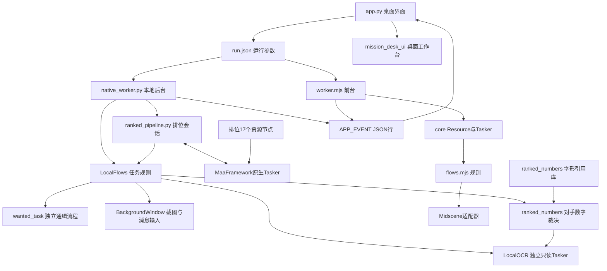

# 火影忍者 Online 助手架构

项目采用桌面界面、工作进程、任务规则、窗口适配和识别资源分层。默认本地后台运行，Midscene前台方式仍可选用。详细设计见[技术文档](技术文档.md)。

## 执行结构

## 职责边界

| 层 | 当前职责 |
| --- | --- |
| 界面 | app.py管理参数、排序、窗口、进程与事件；mission_desk_ui构建工作台，wanted_task_ui提供通缉说明 |
| 工作进程 | 控制命令、串行队列、后台启动校准、事件和错误传播 |
| 本地业务 | 排位原生流水线调度，复用LocalFlows识别；通缉由LocalFlows委派wanted_task，其余任务直接LocalFlows |
| 窗口适配 | 根窗口FramePool截图；渲染子窗口消息输入；DPI映射与几何保护 |
| 本地识别 | 独立只读Maa Tasker执行OCR与模板匹配；ranked_vision读我方／次数，ranked_numbers统一对手数字与字形证据，拒绝未知／冲突 |
| 前台业务 | 应用顺序节点调用flows.mjs，通过SDK进行视觉识别和桌面操作 |
| 故障归档 | SQLite去重，导出Markdown／JSON和截图，人工中断单列 |

resources/tasks.json是共享任务清单。Node执行器还使用其中应用顺序节点，Python后台仅用名称和ID，再分派实际流程；其格式不是官方Maa Pipeline。

resources/maa_ranked/pipeline/ranked.json是本地排位的官方流水线配置，由Python注册Custom动作／识别并选择后继。只有本地排位用该业务流水线，不能称全部任务都由原生Pipeline编排。

ui-preview/mission-desk与ui-preview/scroll-studies是独立网页，静态服务不提供游戏执行接口。前者与桌面工作台的同名视觉方向不代表共用运行状态、配置或验证结果，详见[界面与独立预览边界](技术文档.md#界面与工作进程)。

## 运行与完成条件

本地游戏可被遮挡，最小化不支持；实际运行先校准1920×1015区域，失败或识别不可靠停止，无前台回退。Midscene实际运行切游戏到前台并使用真实鼠标键盘。

stdin接收pause/resume/stop，stdout输出APP_EVENT加JSON。界面读取线程入队，Tk主线程更新状态。停止同时终止工作进程树。

排位正常新挑战要求不同帧业务读数稳定、次数恰好减少一、结算同图复核和主页终态，不能只凭原生作业成功；数字识别失败由native_worker追加保存裁片与裁决诊断。接续来源及次数证据缺口见[核对事项](技术文档.md#核对事项)。通缉仅本地后台，三条终态及继续原队列的条件统一见[通缉实现](技术文档.md#通缉任务)，未知活动页仍停止；押镖仅一次接取，托管可靠结束判断待实施。具体日志与新版本验收边界见[技术文档](技术文档.md#测试与验收)。

## 资源与扩展

resources/local/ocr是运行模型，resources/local/image是共享运行模板，resources/local/wanted是通缉来源及素材；resources/local/ranked_numbers/bank.json引用真实数字像素与变体，不重复生成单字PNG。catalog保存采集截图与索引，部分原像素经明确引用参与制库，不会自动替换运行模板。来源见[资源说明](resources/local/来源说明.md)、[数字库](resources/local/ranked_numbers/bank.json)及[通缉来源](resources/local/wanted/autopath-sources.json)。

新增任务须同步清单、界面参数、后台实现及验证，并明确支持的后端；通缉仅本地后台，由UI阻止前台启动。仅加JSON名字不能得到可运行任务，详见[新增任务与资源维护](技术文档.md#新增任务与资源维护)。
